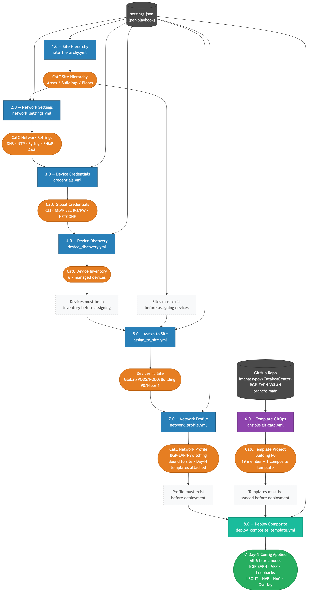

# Cisco Catalyst Center — Ansible Automation Suite

> **As-Built Documentation**
> **Authors:** Igor Manassypov — Systems Engineer (imanassy@cisco.com)
> **Copyright © 2024–2026 Cisco Systems, Inc. All rights reserved.**

This document describes the Ansible automation suite for provisioning the Cat9kv BGP EVPN lab through Cisco Catalyst Center. Stages `1.0`–`9.0` are flat playbooks in `playbooks/` and can run individually or through the ordered `00_site_deploy.yml` playbook. Run all commands from `Support/Resources/Ansible` so the shared `ansible.cfg` is used.

---

## Getting Started

> **Platform:** Ubuntu 22.04 or 24.04
> **Privileges:** A regular user account with `sudo` access

### 1. Clone the Repository and Stage the Server

```bash
git clone https://github.com/kebaldwi/TECOPS-2599.git
cd TECOPS-2599/Support/Resources/Ansible

./0.0-Cisco-Catalyst-Center-Script-Server-Bootstrap/stage-script-server.sh
~/tecops-venv/bin/ansible-playbook -i localhost, 0.0-Cisco-Catalyst-Center-Script-Server-Bootstrap/playbooks/00_preflight.yml
~/tecops-venv/bin/ansible-playbook -i localhost, 0.0-Cisco-Catalyst-Center-Script-Server-Bootstrap/playbooks/01_bootstrap_script_server.yml
```

The staging script supports Ubuntu 22.04/24.04 and installs a pinned toolchain
in `~/tecops-venv`. It prompts for the Catalyst Center admin password and an
Ansible Vault password, then creates the shared encrypted
`campus-evpn/group_vars/all/vault.yml`. See the [bootstrap README](../0.0-Cisco-Catalyst-Center-Script-Server-Bootstrap/README.md)
for details. The Vault password is stored outside the repository in
`~/.ansible/vault_pass` with owner-only permissions. Staging configures the
script-server virtual environment to export its path when activated. If a
shared vault already exists, staging prompts for its Vault password, validates
it, and saves the password file without replacing the vault.

### 2. Encrypted credentials

Staging also creates the encrypted stage vaults with the lab defaults, using
the same Vault password:

| Vault | Contents |
|---|---|
| `campus-evpn/group_vars/all/vault.yml` | Catalyst Center API credentials (all stages) |
| `campus-evpn/vaults/network_settings.yml` | ISE RADIUS shared secrets (stage 2.0) |
| `campus-evpn/vaults/device_credentials.yml` | Device CLI/enable passwords and SNMP communities (stage 3.0) |

Existing vaults are never overwritten. To change a value, run
`ansible-vault edit <vault file>`. The `.example` files show the expected
structure. Stage 6.0 optionally uses `campus-evpn/vaults/github.yml` for a
GitHub token.
All generated vault files are git-ignored. Secrets are intentionally absent
from `Support/Resources/Data-Models/campus-evpn/settings.json`, which retains
the Cat9kv inventory and topology.

### 3. Run the pipeline

From `Support/Resources/Ansible`, run the ordered orchestrator:

```bash
source ~/tecops-venv/bin/activate
ansible-playbook campus-evpn/playbooks/00_site_deploy.yml
```

Each numbered stage can also be run independently from the Ansible root; the
common configuration supplies the campus inventory, and the activated
virtual environment supplies the Vault password file.

See
[Ordering and Dependencies](#ordering-and-dependencies).

---

## Table of Contents

1. [Suite Overview](#suite-overview)
2. [Provisioning Workflow](#provisioning-workflow)
3. [Playbook Reference](#playbook-reference)
   - [1.0 — Site Hierarchy](#10--site-hierarchy)
   - [2.0 — Network Settings](#20--network-settings)
   - [3.0 — Device Credentials](#30--device-credentials)
   - [4.0 — Device Discovery](#40--device-discovery)
   - [5.0 — Assign to Site](#50--assign-to-site)
   - [6.0 — Template GitOps](#60--template-gitops)
   - [7.0 — Network Profile](#70--network-profile)
   - [8.0 — Provision Devices](#80--provision-devices)
   - [9.0 — Composite Template Deployment](#90--composite-template-deployment)
4. [Ansible Module Reference](#ansible-module-reference)
5. [Input Data Sources](#input-data-sources)
6. [Compatibility Matrix](#compatibility-matrix)
7. [Ordering and Dependencies](#ordering-and-dependencies)

---

## Suite Overview

| # | Playbook | File | Outcome in Catalyst Center |
|---|----------|------|---------------------------|
| 1.0 | [Site Hierarchy](docs/01-site-hierarchy.md) | `playbooks/01_site_hierarchy.yml` | Areas, Buildings, and Floors created and fully named |
| 2.0 | [Network Settings](docs/02-network-settings.md) | `playbooks/02_network_settings.yml` | DNS, NTP, Syslog, SNMP, AAA, and banner applied per-site |
| 3.0 | [Device Credentials](docs/03-credentials.md) | `playbooks/03_credentials.yml` | CLI, SNMP v2c R/W, and NETCONF global credentials created and assigned to sites |
| 4.0 | [Device Discovery](docs/04-device-discovery.md) | `playbooks/04_device_discovery.yml` | Devices discovered and added to the CatC Device Inventory |
| 5.0 | [Assign to Site](docs/05-assign-to-site.md) | `playbooks/05_assign_to_site.yml` | Devices placed under their designated site in the hierarchy |
| 6.0 | [Template GitOps](docs/06-template-gitops.md) | `playbooks/06_sync_templates.yml` | Jinja2 and composite templates synced from GitHub into a CatC template project |
| 7.0 | [Network Profile](docs/07-network-profile.md) | `playbooks/07_network_profile.yml` | Switching Network Profile created and assigned to sites with Day-N templates bound |
| 8.0 | [Provision Devices](docs/08-provision-devices.md) | `playbooks/08_provision_devices.yml` | Devices provisioned to their site via SDA provisionDevices API; site-level settings pushed; idempotent skip for already-provisioned devices |
| 9.0 | [Composite Deployment](docs/09-composite-deployment.md) | `playbooks/09_deploy_composite_template.yml` | Composite Day-N templates deployed to managed devices; verification via async task poll |

---

## Ansible Role Layout

Campus-specific automation is organized under `campus-evpn/roles/`. Each
role follows Ansible's standard layout: its entrypoint is
`roles/<role_name>/tasks/main.yml`, with focused task files alongside it.
That `tasks/` directory is part of each role, not a loose project-wide task
directory. The shared `ansible.cfg` searches both the Ansible-root `roles/`
directory and `campus-evpn/roles/`.

## Provisioning Workflow

The following diagram shows the complete end-to-end data flow across all nine playbooks — input sources, playbook execution order, intermediate Catalyst Center resources produced, and hard dependencies between stages.



> **Source:** [docs/diagrams/00-provisioning-workflow.mmd](docs/diagrams/00-provisioning-workflow.mmd)

**Colour coding:**

| Colour | Meaning |
|--------|---------|
| Blue | Infrastructure playbook — reads `settings.json` |
| Purple | GitHub-sourced playbook — fetches templates from a git repository (6.0) |
| Teal | Deployment playbooks — push configuration onto managed devices (8.0, 9.0) |
| Dark grey | Input data source (`settings.json`, GitHub repo) |
| Orange | Catalyst Center resource produced by a playbook |
| Green | Final deployed state — devices with Day-N configuration applied |
| White | Ordering constraint annotation |

---

## Playbook Reference

### 1.0 — Site Hierarchy

**Playbook:** [`playbooks/01_site_hierarchy.yml`](playbooks/01_site_hierarchy.yml)
**Full README:** [docs/01-site-hierarchy.md](docs/01-site-hierarchy.md)
**Configured CatC:** 3.1.6 | **Collection:** `cisco.catalystcenter 2.14.0`

#### Function

Automates the creation, update, and deletion of the Site Hierarchy in Catalyst Center. The hierarchy is the fundamental grouping structure — Areas, Buildings, and Floors — that all subsequent playbooks depend upon for site-scoped operations.

The playbook reads `settings.json`, derives all intermediate path segments from each entry's `HierarchyParent/Area/Bldg/Floor` fields, de-duplicates and depth-sorts the resulting path list, then processes each site via typed collection modules in shallow-to-deep order. New site UUIDs are captured immediately after creation and fed forward to parent resolution for the next iteration.

#### Outcome in Catalyst Center

- Site Hierarchy tree populated with all Areas, Buildings, and Floors defined in `settings.json`
- Each site assigned correct metadata: building address + GPS coordinates, floor dimensions, RF model, and units of measure
- All sites immediately addressable by UUID in subsequent playbooks
- Deletion reverses the order (deepest first) to respect parent-child constraints

| Action | Module / Mechanism |
|--------|-------------------|
| Fetch all existing sites | `cisco.catalystcenter.sites_info` → `site_hierarchy_site_id_map` |
| Create area | `cisco.catalystcenter.areas` (state: present, no `id:`) |
| Create building | `cisco.catalystcenter.buildings` (state: present, no `id:`) |
| Create floor | `cisco.catalystcenter.floors` (state: present; `unitsOfMeasure` required) |
| Update existing site | Typed module with `id:` resolved from `site_hierarchy_site_id_map` |
| Delete site | Typed module (state: absent, deepest-first order) |

---

### 2.0 — Network Settings

**Playbook:** [`playbooks/02_network_settings.yml`](playbooks/02_network_settings.yml)
**Full README:** [docs/02-network-settings.md](docs/02-network-settings.md)
**Configured CatC:** 3.1.6 | **Collection:** `cisco.catalystcenter 2.14.0`

#### Function

Applies site-scoped network infrastructure settings to each site defined in `settings.json`. Settings include DNS (domain name, primary and secondary server IPs), DHCP server, NTP server list, timezone, message-of-the-day banner, SNMP server, Syslog server, and AAA (client-and-endpoint only, bypassing the RADIUS shared-secret cross-check constraint of the workflow manager module).

The playbook uses a raw `ansible.builtin.uri` call to `PUT /dna/intent/api/v1/network/{siteId}` rather than the `network_settings_workflow_manager` collection module, avoiding the `NCND01243: sharedSecret cannot be different` error that arises when `network_aaa` and `clientAndEndpoint_aaa` share overlapping server entries. After each PUT, the async `executionStatusUrl` is polled until CatC reports `SUCCESS` or `FAILURE`.

#### Outcome in Catalyst Center

- DNS, DHCP, NTP, timezone, banner, SNMP, and Syslog settings visible under **Design → Network Settings → Network** for each targeted site
- AAA (ISE/RADIUS) bound to the site via `clientAndEndpoint_aaa` without triggering the Rhino script type-check error on `retainExistingBanner`
- Settings applied exactly as defined without inheritance side-effects from parent sites

| Action | Module / Mechanism |
|--------|-------------------|
| Resolve site path → UUID | `cisco.catalystcenter.sites_info` (Phase A) |
| Authenticate | `ansible.builtin.uri` → `POST /dna/system/api/v1/auth/token` |
| Apply settings | `ansible.builtin.uri` → `PUT /dna/intent/api/v1/network/{siteId}` |
| Poll execution result | `ansible.builtin.uri` → `GET /dna/intent/api/v1/dnacaap/management/execution-status/{executionId}` |

---

### 3.0 — Device Credentials

**Playbook:** [`playbooks/03_credentials.yml`](playbooks/03_credentials.yml)
**Full README:** [docs/03-credentials.md](docs/03-credentials.md)
**Minimum CatC:** 2.3.7.6 | **Collection:** `cisco.dnac ≥ 6.7.0`

#### Function

Creates, updates, deletes, and site-assigns global device credentials — CLI (SSH/Telnet), SNMP v2c Read, SNMP v2c Write, and NETCONF. CLI and SNMP credentials are handled by the `device_credential_workflow_manager` collection module in a single idempotent call that handles both creation and assignment. NETCONF credentials are managed separately via raw module calls because the workflow manager does not support the NETCONF credential subtype; a re-query pattern resolves the newly assigned UUID after each `POST` (working around the empty-body HTTP 201 SDK quirk).

#### Outcome in Catalyst Center

- CLI, SNMP v2c R/W, and NETCONF global credentials visible under **Design → Credentials**
- Credentials assigned to designated sites ready for use by the Device Discovery playbook
- Deletion removes all matching credentials by description, leaving unmanaged credentials untouched

| Action | Module / Mechanism |
|--------|-------------------|
| Create / update CLI + SNMP v2c | `cisco.dnac.device_credential_workflow_manager` (state: merged) |
| Assign credentials to sites | `cisco.dnac.device_credential_workflow_manager` (`assign_credentials_to_site`) |
| Delete CLI + SNMP v2c | `cisco.dnac.device_credential_workflow_manager` (state: deleted) |
| Query existing NETCONF credentials | `cisco.dnac.global_credential_info` (credentialSubType: NETCONF) |
| Create NETCONF credential | `cisco.dnac.netconf_credential` (state: present, payload list; `ignore_errors: true`) |
| Update NETCONF credential | `cisco.dnac.netconf_credential` (state: present, `id:` + scalar fields) |
| Delete NETCONF credential | `cisco.dnac.global_credential_delete` (globalCredentialId) |

---

### 4.0 — Device Discovery

**Playbook:** [`playbooks/04_device_discovery.yml`](playbooks/04_device_discovery.yml)
**Full README:** [docs/04-device-discovery.md](docs/04-device-discovery.md)
**Minimum CatC:** 2.3.7.6 | **Collection:** `cisco.dnac 6.46.0`

#### Function

Submits device discovery jobs to Catalyst Center using the `device_list` and optional `discovery` configuration in each `settings.json` project entry. Discovery jobs reference credentials by description (not by secret value), using the global credentials created in playbook 3.0. The `discovery_workflow_manager` module submits the job and polls until the discovery reaches a terminal state.

#### Outcome in Catalyst Center

- Each listed device reachable via the provided management IPs appears in **Provision → Inventory**
- Devices are in `Managed` state with SSH/SNMP/NETCONF reachability confirmed
- Discovery jobs visible under **Tools → Discovery**

| Action | Module / Mechanism |
|--------|-------------------|
| Submit discovery job and poll for completion | `cisco.dnac.discovery_workflow_manager` (state: merged) |

---

### 5.0 — Assign to Site

**Playbook:** [`playbooks/05_assign_to_site.yml`](playbooks/05_assign_to_site.yml)
**Full README:** [docs/05-assign-to-site.md](docs/05-assign-to-site.md)
**Minimum CatC:** 2.3.7.6 | **Collection:** `cisco.dnac 6.46.0`

#### Function

Assigns discovered devices to their designated sites in the Catalyst Center hierarchy. The playbook reads `device_list` from the shared `settings.json`, groups device IPs by site path, resolves each site path to a UUID via a `site_info` lookup, and calls `assign_device_to_site` once per unique site with the complete IP list for that site.

#### Outcome in Catalyst Center

- Devices appear under their correct site in **Provision → Inventory** (site column populated)
- Devices are eligible for site-scoped provisioning, template deployment, and network profile binding
- Site assignment is a prerequisite for device provisioning (playbook 8.0) and composite template deployment (playbook 9.0)

| Action | Module / Mechanism |
|--------|-------------------|
| Resolve site name → UUID | `cisco.dnac.site_info` |
| Assign device IP list to site | `cisco.dnac.assign_device_to_site` |

---

### 6.0 — Template GitOps

**Playbook:** [`playbooks/06_sync_templates.yml`](playbooks/06_sync_templates.yml)
**Full README:** [docs/06-template-gitops.md](docs/06-template-gitops.md)
**Minimum CatC:** 2.3.7.6 | **Collection:** `cisco.dnac 6.46.0`

#### Function

Implements a GitOps synchronisation workflow between a GitHub repository and a Catalyst Center template project. All content is fetched at runtime via the GitHub REST API — no local repository clone is required. The playbook discovers all `.j2` (Jinja2) and `.yml` (composite definition) files under a configured subfolder in the repository, enriches them with last-commit metadata, determines a processing order that guarantees individual templates exist before the composites that reference them, and syncs all templates and composites to Catalyst Center in two ordered `template_workflow_manager` calls.

#### Outcome in Catalyst Center

- All Jinja2 templates under `git_repo_subfolder/` created or updated in the target CatC template project
- Composite templates created with correct `containingTemplates` member lists
- Template description fields populated with git commit timestamp, author, and message for full audit traceability
- Subsequent runs are idempotent — only changed templates are updated

| Action | Module / Mechanism |
|--------|-------------------|
| Fetch repository file tree | `ansible.builtin.uri` → `GET /repos/{slug}/git/trees/{branch}?recursive=1` |
| Fetch raw template content | `ansible.builtin.uri` → `GET raw.githubusercontent.com/{slug}/{branch}/{path}` |
| Fetch last commit metadata | `ansible.builtin.uri` → `GET /repos/{slug}/commits?path={path}&per_page=1` |
| Sync individual Jinja2 templates | `cisco.dnac.template_workflow_manager` (state: merged) |
| Sync composite templates | `cisco.dnac.template_workflow_manager` (state: merged, composite: true) |

---

### 7.0 — Network Profile

**Playbook:** [`playbooks/07_network_profile.yml`](playbooks/07_network_profile.yml)
**Full README:** [docs/07-network-profile.md](docs/07-network-profile.md)
**Minimum CatC:** 2.3.7.9 | **Collection:** `cisco.dnac 6.46.0`

#### Function

Creates Switching Network Profiles in Catalyst Center and assigns them to one or more sites with Day-N and/or onboarding templates bound. Network profiles are the mechanism by which Catalyst Center knows which templates to use when provisioning a device at a given site. The `network_profile_switching_workflow_manager` module handles template name resolution, site UUID resolution, profile creation, and site assignment in a single idempotent `state: merged` call.

#### Outcome in Catalyst Center

- Named Switching Network Profile visible under **Design → Network Profiles**
- Profile bound to the specified sites with the configured Day-N template(s) listed
- Profile ready to be selected during device provisioning (playbook 8.0) and referenced by the composite deployment playbook (9.0)

| Action | Module / Mechanism |
|--------|-------------------|
| Create, update, and site-assign Switching Network Profile | `cisco.dnac.network_profile_switching_workflow_manager` (state: merged) |

---

### 8.0 — Provision Devices

**Playbook:** [`playbooks/08_provision_devices.yml`](playbooks/08_provision_devices.yml)
**Full README:** [docs/08-provision-devices.md](docs/08-provision-devices.md)
**Minimum CatC:** 2.3.7.6 | **Collection:** `cisco.dnac 6.46.0`

#### Function

Provisions managed network devices to their designated sites in Catalyst Center using the SDA `provisionDevices` REST API (`POST /dna/intent/api/v1/sda/provisionDevices`). Provisioning is the step that pushes site-level network settings (DNS, NTP, SNMP, syslog, netflow, AAA) configured in playbook 2.0 onto the physical devices, and creates the CatC-internal provisioning record that links each `networkDeviceId` to its `siteId`. This record is required by the composite template deployment pipeline (playbook 9.0).

The playbook reads `settings.json`, groups devices by site path, authenticates once to get a JWT, then for each site: resolves the site UUID, resolves device UUIDs per management IP, checks which devices are already provisioned at the site (idempotency), and submits a batched `POST` for the remaining devices. The async task returned by CatC is polled to completion per site, and a structured per-site summary is printed.

#### Outcome in Catalyst Center

- Devices appear in **Provision → Inventory** with a provisioning status of `Success`
- Site-level network settings (DNS, NTP, SNMP, AAA, syslog) applied to device running configuration
- SDA provisioning record created — required for composite template deployment
- Already-provisioned devices are skipped (idempotent); use `force_reprovision=true` to re-trigger

| Action | Module / Mechanism |
|--------|-------------------|
| Authenticate | `ansible.builtin.uri` → `POST /dna/system/api/v1/auth/token` |
| Resolve site UUID | `ansible.builtin.uri` → `GET /dna/intent/api/v1/site?name={path}` |
| Resolve device UUID | `ansible.builtin.uri` → `GET /dna/intent/api/v1/network-device?managementIpAddress={ip}` |
| Check provisioned state | `ansible.builtin.uri` → `GET /dna/intent/api/v1/sda/provisionDevices?siteId={uuid}&limit=500` |
| Provision devices (batch) | `ansible.builtin.uri` → `POST /dna/intent/api/v1/sda/provisionDevices` |
| Poll async task | `ansible.builtin.uri` → `GET /dna/intent/api/v1/task/{taskId}` (until `endTime` set) |

---

### 9.0 — Composite Template Deployment

**Playbook:** [`playbooks/09_deploy_composite_template.yml`](playbooks/09_deploy_composite_template.yml)
**Full README:** [docs/09-composite-deployment.md](docs/09-composite-deployment.md)
**Minimum CatC:** 2.3.7.6 | **Collection:** `cisco.dnac 6.46.0`

#### Function

Deploys composite Day-N templates to managed devices. A composite template bundles multiple member Jinja2 templates (VRF definitions, loopbacks, overlay, NVE, multicast, etc.) into a single atomic deployment unit. The playbook resolves all required UUIDs from Catalyst Center at runtime — template root UUID, latest committed version UUID, member template UUIDs, and device UUIDs from management IPs — constructs the full `memberTemplateDeploymentInfo` payload, and calls the v2 deploy API once per device. Each deploy call is tracked to completion by polling the async task endpoint.

#### Outcome in Catalyst Center

- Composite Day-N templates pushed to each targeted device
- Device running configuration updated with all member template outputs (VRF, NVE, overlay, multicast, loopbacks, etc.)
- Deployment task status and per-device results visible under **Provision → Templates → Template Deployment**
- Any member-level or task-level failure surfaces with device IP, task ID, and error detail

| Action | Module / Mechanism |
|--------|-------------------|
| Authenticate | `ansible.builtin.uri` → `POST /dna/system/api/v1/auth/token` |
| Resolve template version UUIDs + member list | `ansible.builtin.uri` → `GET /dna/intent/api/v1/template-programmer/template?projectNames={name}` |
| Fetch composite member template list | `ansible.builtin.uri` → `GET /dna/intent/api/v1/template-programmer/template/{templateId}` |
| Resolve device UUID from management IP | `ansible.builtin.uri` → `GET /dna/intent/api/v1/network-device?managementIpAddress={ip}` |
| Deploy composite template (per device) | `cisco.dnac.configuration_template_deploy_v2` |
| Poll async deploy task | `ansible.builtin.uri` → `GET /dna/intent/api/v1/task/{taskId}` (until `endTime` set) |

---

---

## Ansible Module Reference

The following table lists every Ansible module used across the suite, the collection it belongs to, where it is used, and the Ansible Galaxy documentation link.

| Module | Collection | Used In | Galaxy Docs |
|--------|-----------|---------|-------------|
| `areas` | `cisco.catalystcenter` | 1.0 Site Hierarchy | [docs](https://galaxy.ansible.com/ui/repo/published/cisco/catalystcenter/content/module/areas/) |
| `buildings` | `cisco.catalystcenter` | 1.0 Site Hierarchy | [docs](https://galaxy.ansible.com/ui/repo/published/cisco/catalystcenter/content/module/buildings/) |
| `floors` | `cisco.catalystcenter` | 1.0 Site Hierarchy | [docs](https://galaxy.ansible.com/ui/repo/published/cisco/catalystcenter/content/module/floors/) |
| `sites_info` | `cisco.catalystcenter` | 1.0 Site Hierarchy, 2.0 Settings | [docs](https://galaxy.ansible.com/ui/repo/published/cisco/catalystcenter/content/module/sites_info/) |
| `device_credential_workflow_manager` | `cisco.dnac` | 3.0 Credentials | [docs](https://galaxy.ansible.com/ui/repo/published/cisco/dnac/content/module/device_credential_workflow_manager/) |
| `global_credential_info` | `cisco.dnac` | 3.0 Credentials | [docs](https://galaxy.ansible.com/ui/repo/published/cisco/dnac/content/module/global_credential_info/) |
| `netconf_credential` | `cisco.dnac` | 3.0 Credentials | [docs](https://galaxy.ansible.com/ui/repo/published/cisco/dnac/content/module/netconf_credential/) |
| `global_credential_delete` | `cisco.dnac` | 3.0 Credentials | [docs](https://galaxy.ansible.com/ui/repo/published/cisco/dnac/content/module/global_credential_delete/) |
| `discovery_workflow_manager` | `cisco.dnac` | 4.0 Device Discovery | [docs](https://galaxy.ansible.com/ui/repo/published/cisco/dnac/content/module/discovery_workflow_manager/) |
| `site_info` | `cisco.dnac` | 5.0 Assign to Site | [docs](https://galaxy.ansible.com/ui/repo/published/cisco/dnac/content/module/site_info/) |
| `assign_device_to_site` | `cisco.dnac` | 5.0 Assign to Site | [docs](https://galaxy.ansible.com/ui/repo/published/cisco/dnac/content/module/assign_device_to_site/) |
| `template_workflow_manager` | `cisco.dnac` | 6.0 Template GitOps | [docs](https://galaxy.ansible.com/ui/repo/published/cisco/dnac/content/module/template_workflow_manager/) |
| `network_profile_switching_workflow_manager` | `cisco.dnac` | 7.0 Network Profile | [docs](https://galaxy.ansible.com/ui/repo/published/cisco/dnac/content/module/network_profile_switching_workflow_manager/) |
| `configuration_template_deploy_v2` | `cisco.dnac` | 9.0 Composite Deployment | [docs](https://galaxy.ansible.com/ui/repo/published/cisco/dnac/content/module/configuration_template_deploy_v2/) |
| `ansible.builtin.uri` | Ansible Core | 2.0, 6.0, 8.0, 9.0 | [docs](https://docs.ansible.com/ansible/latest/collections/ansible/builtin/uri_module.html) |

### Collection Installation

```bash
# cisco.catalystcenter (used by playbooks 1.0 and 2.0)
ansible-galaxy collection install cisco.catalystcenter:==2.14.0

# cisco.dnac (used by playbooks 3.0–9.0)
ansible-galaxy collection install cisco.dnac:==6.46.0
```

Or install all dependencies at once from any playbook directory using the shared `requirements.yml`:

```bash
ansible-galaxy collection install -r requirements.yml
```

> **Note:** `cisco.catalystcenter` and `cisco.dnac` are maintained as separate collections on Ansible Galaxy. Playbooks 1.0 and 2.0 use `cisco.catalystcenter` (newer API structure, `catalystcenter_response` key, `nameHierarchy` attribute). Playbooks 3.0–8.0 use `cisco.dnac` (legacy key names but broader module coverage). Do not substitute one for the other — the response schemas differ.

---

## Input Data Sources

Stages 1.0–5.0 and 7.0–9.0 read the same project `settings.json`; stage 6.0 reads its template source from GitHub.

### `settings.json`

Used by: **1.0–5.0, 7.0–9.0**

Each `project[]` entry describes a site hierarchy, network settings, device credential labels, comma-separated `device_list`, network profile, and wired device discovery options. The Cat9kv device list and topology remain in this file. It has no `lab` or wireless/WLC configuration.

The `discovery` object is optional; defaults preserve the existing MULTI RANGE/SSH behavior. This lab uses `preferred_mgmt_ip_method: UseLoopBack` with the six fabric nodes' Loopback0 addresses. The object supports `enabled`, `discovery_name`, `discovery_type`, `protocol_order`, `retry`, `timeout`, `preferred_mgmt_ip_method`, `enable_netconf`, and `netconf_port`.

Credential descriptions and usernames remain in settings. Passwords, enable passwords, SNMP communities, and AAA shared secrets belong in their stage's encrypted Vault file and are merged into API payloads at runtime.

```
Projects/
└── BGP_EVPN/
    └── Settings/
        └── settings.json
```

### GitHub Repository

Used by: **6.0**

Jinja2 template files (`.j2`) and composite definitions (`.yml`) stored in a subfolder of the configured GitHub repository. Fetched at runtime via the GitHub REST API — no local clone required.

| Parameter | Value |
|-----------|-------|
| `git_repo` | `https://github.com/imanassypov/CatalystCenter-BGP-EVPN-VXLAN.git` |
| `git_branch` | `main` (configurable via `inventories/lab/hosts.yml`) |
| `git_repo_subfolder` | `BGP EVPN` |

---

## Configured Runtime Versions

The lab appliance is Catalyst Center 3.1.6. The Ansible SDK modules use API
profile `3.1.6.0`; this is the API version identifier, not the pip package
version. These pins configure the pipeline but do not indicate that a live
deployment has been validated against the appliance.

| Component | Configured version |
|-----------|--------------------|
| Catalyst Center appliance | 3.1.6 |
| SDK API profile (`catc_version` / `dnac_version`) | 3.1.6.0 |
| `catalystcentersdk` | 3.1.6.0.7 |
| `dnacentersdk` | 2.11.2 |
| `cisco.catalystcenter` collection | 2.14.0 |
| `cisco.dnac` collection | 6.46.0 |
| `ansible-core` | 2.17.14 |

---

## Ordering and Dependencies

Run `00_site_deploy.yml` to execute stages 1.0–9.0 in order. Individual stage
playbooks can also be run from the common Ansible root.

```
1.0 Site Hierarchy
      │  Creates the site tree — all other playbooks require sites to exist
      ▼
2.0 Network Settings          3.0 Device Credentials
      │  (can run in either order — both depend only on 1.0)
      └──────────────┬─────────────────────┘
                     ▼
             4.0 Device Discovery
                   │  Requires global credentials from 3.0
                   ▼
             5.0 Assign to Site
                   │  Requires discovered devices from 4.0
                   ▼
             8.0 Provision Devices
                   │  Pushes site settings; creates SDA provisioning record required by 9.0
                   │
      ┌────────────┘
      │
      │   6.0 Template GitOps  ←  (independent; can run any time after repo is configured)
      │         │
      │         ▼
      │   7.0 Network Profile
      │         │  Requires sites (1.0) and templates (6.0)
      │         │
      └─────────┴────────────▶  9.0 Composite Deployment
                                     Requires: provisioned devices (8.0)
                                               templates in CatC (6.0)
                                               profile bound to sites (7.0)

```

**Deletion runs in reverse order** — 9.0 → 8.0 → 7.0 → 6.0 → 5.0 → 4.0 → 3.0 → 2.0 → 1.0 — to respect parent-child and dependency constraints.
